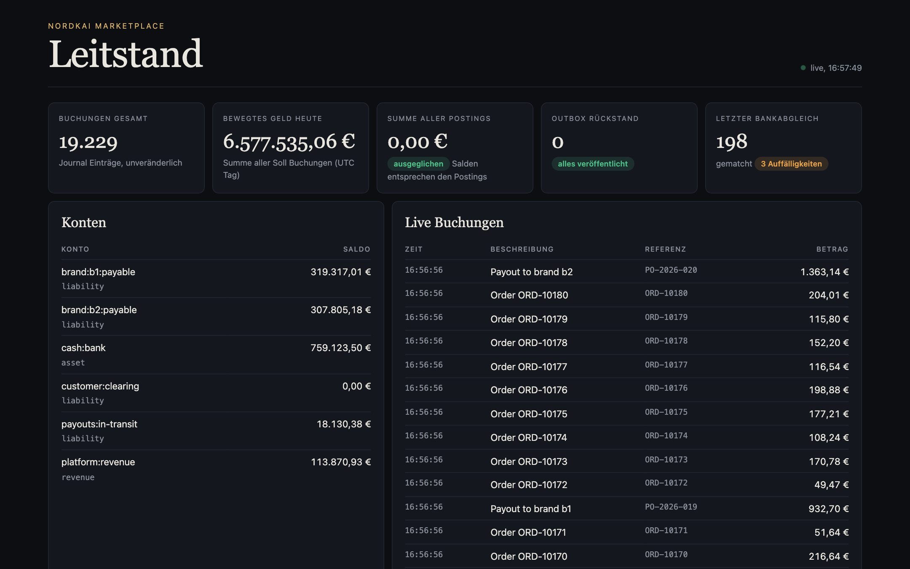
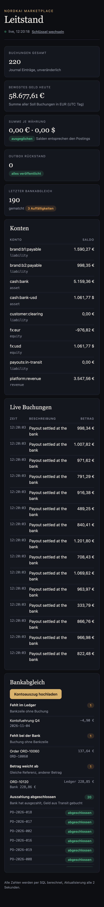

# Ledger Lane

**A double entry ledger for a marketplace that survives retries and a kill -9 without losing or inventing a single cent.**

▶ [24 s teaser and project page](https://omaraldulimay.github.io/projekte/ledger-lane.html)

| Chaos run | Result |
|---|---|
| Transfers sent | 100.000 |
| Crashes (kill -9) | 1 |
| Difference to the cent | 0 |
| Throughput | 410 transfers/s (laptop, under load) |
| Latency p95 | 168 ms |

Details in `docs/chaos/report.md`.

A double entry ledger service for a marketplace: it records every money movement between customer, platform and
partner brands so that each cent can be explained. Java 21, Spring Boot 4, plain SQL on PostgreSQL. See `docs/architecture.md`.

## Decisions

- [0001 Double entry with integer cents](docs/adr/0001-double-entry-integer-cents.md)
- [0002 Stored balance with row locks in id order](docs/adr/0002-stored-balance-with-row-locks.md)
- [0003 Idempotency key inserted first](docs/adr/0003-idempotency-key-first.md)
- [0004 Transactional outbox](docs/adr/0004-transactional-outbox.md)
- [0005 Plain SQL with JdbcClient instead of JPA](docs/adr/0005-plain-sql-jdbcclient.md)
- [0006 Upgrade to Spring Boot 4](docs/adr/0006-upgrade-to-spring-boot-4.md)
- [0007 API keys with roles](docs/adr/0007-api-keys-with-roles.md)
- [0008 Several currencies, balanced per currency](docs/adr/0008-multi-currency.md)

## Invariants

1. Every journal entry has at least two postings, and the postings of each currency sum to exactly 0.
2. Amounts are integer cents with a currency, never floating point.
3. Entries and postings are immutable (enforced by database triggers). Mistakes are fixed with a reversal entry.
4. Every write carries an `Idempotency-Key`. Same key and body replays the original response, same key and a different body is a 409.
5. Accounts flagged as not negative reject any posting that would push their normal balance below zero (422).
6. Per currency, the sum of all postings is 0, and every account balance equals the sum of its postings. The tests check this after every scenario.

## Run

Needs Java 21. Without Docker, `make` uses a throwaway Postgres 16 on port 55433 (binaries from `/Library/PostgreSQL/16/bin`, data in `.local/pg`).

    make test      # starts the local database if Docker is missing, then ./mvnw verify
    make run       # demo profile on http://localhost:8095 (PORT=... to change), database ledger_demo, seeds accounts for brands b1 and b2
    make demo-reset # recreates only the throwaway database ledger_demo (stop the app first)
    make demo-data # posts 200 transfers with references, writes docs/demo/bank-statement.csv
    make chaos     # 100k transfers with duplicates and a kill -9, report in docs/chaos (N=... CONCURRENCY=...)
    make db-down   # stop the local database

With Docker, `./mvnw verify` starts Postgres through Testcontainers. Otherwise set `LEDGER_TEST_DB_URL`,
`LEDGER_TEST_DB_USER` and `LEDGER_TEST_DB_PASSWORD`. API docs: `/swagger-ui.html`, metrics: `/actuator/prometheus`.

## Access

Every `/v1` call needs an `X-Api-Key` header. Only SHA-256 hashes of the keys are configured. Roles:

| Role | May |
|---|---|
| SHOP | post transfers and reversals |
| FINANCE | reversals, payouts, reconciliations, create accounts, read |
| AUDITOR | read only |

The demo profile has the keys `demo-shop`, `demo-finance` and `demo-auditor`. Missing or unknown key is `401`,
a key without the role is `403`, both as problem+json. The Leitstand, health and the API docs are public.

## Example

A customer pays 100,00 EUR for a product of brand b1, with 15 % commission:

    curl -i -X POST localhost:8095/v1/transfers -H 'X-Api-Key: demo-shop' \
      -H 'Content-Type: application/json' -H 'Idempotency-Key: order-1001' \
      -d '{"description":"order 1001","postings":[
            {"accountId":"cash:bank","amount":10000,"currency":"EUR"},
            {"accountId":"brand:b1:payable","amount":-8500,"currency":"EUR"},
            {"accountId":"platform:revenue","amount":-1500,"currency":"EUR"}]}'

Sending the same request again returns `200` with the same body and `Idempotent-Replayed: true`.
Positive amounts are debits, negative amounts are credits.

Several currencies: an entry may mix currencies, but each currency must sum to 0 on its own. A US customer
paying 110,00 USD for a brand paid in EUR goes through the exchange accounts `fx:usd` and `fx:eur`:
`cash:bank-usd +11000 USD`, `fx:usd -11000 USD`, `fx:eur +10120 EUR`, `brand:b1:payable -8602 EUR`,
`platform:revenue -1518 EUR`. A posting in a currency other than its account's is rejected, by the service and
again by a database trigger.

## Payouts

Pay a brand its payable balance (or part of it) into `payouts:in-transit`. `amount` is optional, in cents.
Over the balance or zero is a `422`.

A payout is closed by the bank reconciliation: when the statement shows it, the same run books
`payouts:in-transit` against `cash:bank`, so the money leaves the bank account. The payout row is locked first and
`settles_entry_id` is unique, so two reconciliations at the same time settle a payout exactly once.

    curl -i -X POST localhost:8095/v1/payouts -H 'X-Api-Key: demo-finance' \
      -H 'Content-Type: application/json' -H 'Idempotency-Key: payout-2026-w45-b1' \
      -d '{"brandId":"b1","amount":8500}'

## Events: outbox and Kafka

Every journal entry (transfer, reversal, payout) writes an `outbox` row in the same transaction, so an entry is
published if and only if it exists. A relay claims unpublished rows with `SELECT ... FOR UPDATE SKIP LOCKED`
in id order, publishes them and sets `published_at`. Publishing is **at least once**: a crash between publish and
commit sends a row again. The message key is the entry id and the payload carries `id`, `description`,
`reversesEntryId`, `createdAt` and `postings`, so **consumers dedupe by entry id**.

    LEDGER_OUTBOX_PUBLISHER=kafka LEDGER_KAFKA_BOOTSTRAP=localhost:9092 make run

Default is `log`, which only logs the messages. The Kafka publisher uses topic `ledger.entries`, `acks=all`,
an idempotent producer and waits for the broker acknowledgement before marking a row. The Kafka test uses
Testcontainers and is skipped when Docker is missing.

## Bank reconciliation

Transfers and payouts accept an optional `reference` (order id, payout id), stored on the journal entry.
`POST /v1/reconciliations` takes a bank statement as `text/csv` with the columns
`booking_date,amount_cents,reference,counterparty` and matches it against the postings on `cash:bank` and
`payouts:in-transit` by reference and amount. Money in is positive, money out is negative. The answer holds the
matched count and three lists: `missingInLedger` (bank line without entry), `missingAtBank` (entry without bank line)
and `amountMismatch` (same reference, different amount), plus `settledPayouts`, the payouts this run closed. Entries without a reference cannot be matched and are ignored.
Every run is stored in `reconciliation_runs`.

    make run         # terminal 1
    make demo-data   # terminal 2, 200 transfers and a matching statement with 3 deliberate discrepancies
    curl -X POST localhost:8095/v1/reconciliations -H 'X-Api-Key: demo-finance' -H 'Content-Type: text/csv' --data-binary @docs/demo/bank-statement.csv

## Leitstand

Open http://localhost:8095 and enter `demo-finance` for the control room: entries, money moved today, the sum of all postings with a
balanced badge, outbox lag, the latest reconciliation, account balances, a live feed and an upload button for
statements. It is one static page that polls `GET /v1/dashboard` every 2 seconds. The balance check is computed
in SQL on every request (sum of postings, and each balance against its postings), nothing is cached.

On a phone the page stacks into one column:

